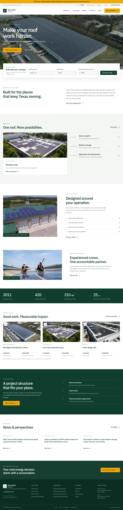
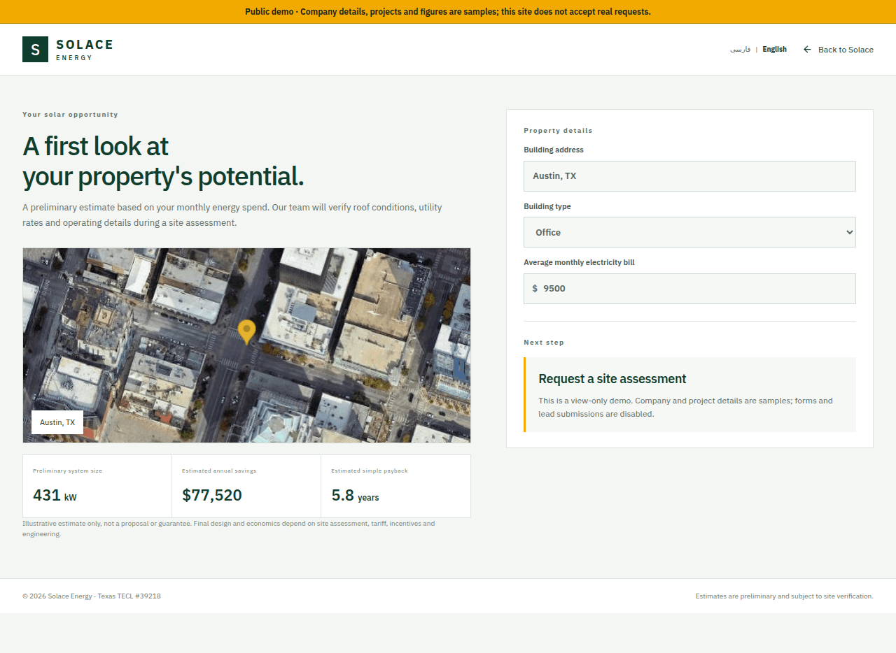
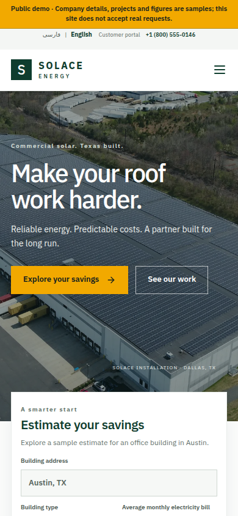

# Solace Energy — Commercial Solar for Texas

Solace is a bilingual, full-stack website concept for a Texas commercial solar installer. This repository currently ships a clearly labelled **read-only demonstration**. The first-visit language remains Persian (RTL); visitors can switch to English, or open the site with `?lang=en` for an English-first view.

> **Live demo status:** A permanent public deployment has not yet been confirmed. The GitHub-connected project must be published from its Manus Dashboard. This README will be updated with the verified public URL only after deployment succeeds. Do not treat a temporary Preview URL as the live demo.

## English screenshots

### Homepage



### Estimate page



### Homepage on mobile



## Public-demo safety

The current release is for demonstration only. Sample property and estimate values are not a quote, engineering assessment, or claim about an actual customer. The public-demo guard is enabled in `shared/site-mode.ts` (`IS_PUBLIC_DEMO = true`):

- Lead submissions and owner-notification mutations are rejected on the server; the demo does not collect or store visitor contact details.
- The owner lead-list endpoint is blocked, and `/admin` displays a demo notice rather than exposing records.
- The map proxy only accepts the fixed Austin, Texas sample address and caches that response; arbitrary visitor addresses are rejected.
- Sample company, case-study, savings, and news content must not be represented as verified company facts.

Do not disable the demo guard or enable real lead capture until the company content, data handling, legal copy, authorization, and production services have been reviewed.

## Demo routes

- `/?lang=en` — English view of the homepage. Without a language query or saved preference, the first visit is Persian.
- `/estimate?demo=1&lang=en` — English read-only sample estimate for Austin, TX. The sample inputs are fixed and contact capture is unavailable.
- `/admin` — Owner area is closed in the public demo.

The screenshots are committed below `docs/assets/` so they render directly in GitHub. GitHub Pages cannot run this full-stack application: the site needs its Node/Express server, database, OAuth/session configuration, and platform Maps proxy for a complete deployment.

## Features represented in the codebase

- Corporate navigation, solar solutions and industries, company figures, illustrative project case studies, financing, news, and a dense footer.
- Persian-default and English UI with saved language selection and RTL/LTR direction changes.
- A sample property estimate with system-size, annual-savings, and simple-payback calculations.
- Production-intended lead, owner-notification, owner-only admin, and CSV-export flows, all disabled or blocked while public-demo mode is active.

## Technology

React 19, TypeScript, Vite, Express, tRPC, Drizzle ORM, MySQL, and Tailwind CSS. Frontend routes are registered in `client/src/App.tsx`; the platform route manifest is `client/public/manus-routes.json`.

## Local development

Requirements: Node.js compatible with the deployment runtime, `pnpm`, and a MySQL-compatible database for database-backed development. Configure runtime credentials through a secure environment or secret manager; never commit a real `.env` file.

```bash
pnpm install
pnpm db:migrate
pnpm dev
```

Useful checks:

```bash
pnpm check
pnpm test
pnpm build
```

Use `pnpm db:migrate` to apply checked-in migrations. `pnpm db:push` is for an intentional schema change, not routine startup. See [Development and deployment](docs/development.md) for environment setup and hosting details.

## Documentation

- [Demo guide and current release status](docs/demo.md)
- [Application architecture](docs/architecture.md)
- [Lead management, estimates, and access controls](docs/lead-management.md)
- [Development, configuration, and deployment](docs/development.md)
- [Contributing guide](CONTRIBUTING.md)

## Content and launch checklist

The company figures shown in the site (founded 2011, 420 employees, and 310 MW installed) came from the project brief and have not been independently verified. Client names, case studies, savings figures, and news are illustrative placeholders. Before a commercial launch, replace or approve them; confirm image-use rights, locations, licences, contact details, Customer Portal and Careers destinations; review privacy, terms, accessibility and estimate assumptions; and run production checks for the database, OAuth, and notifications. The current project checklist is in [`TODO.md`](TODO.md).

## License

The project code is provided under the MIT License in `LICENSE`. Third-party photographs, trademarks, and other assets are not necessarily covered by that license; confirm their rights before commercial use.
