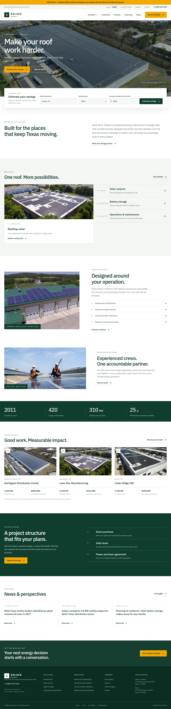
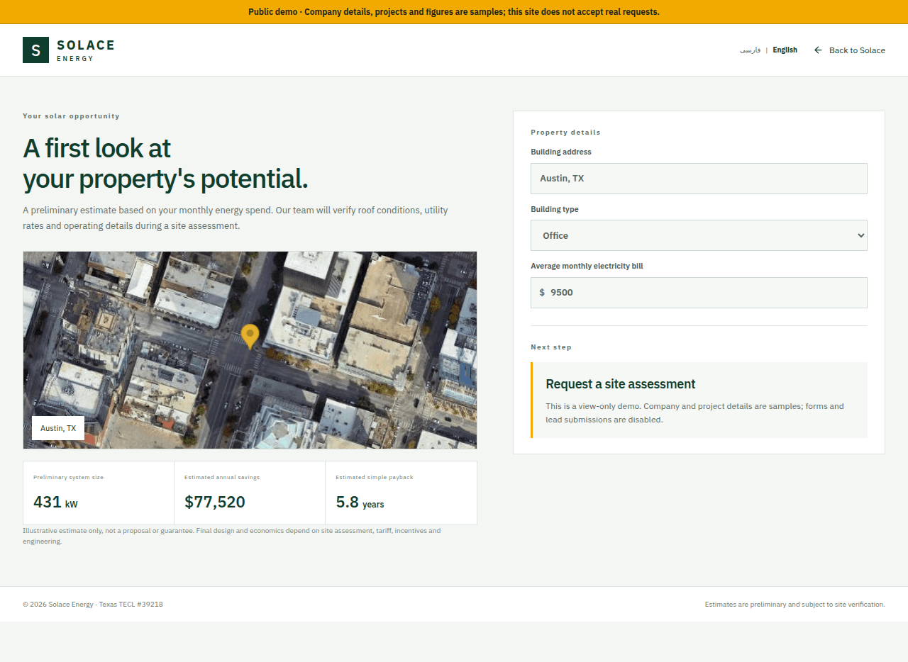

# Demo Guide

## Release status

This repository contains a clearly labelled **read-only demo**. A permanent public live-demo URL is not yet available: the GitHub-canonical website must be published from the Manus Dashboard, and success must be confirmed before a URL is shared. The temporary project Preview is for review only and is not a live-demo link.

## English screenshots

### Homepage



### Sample estimate



### Homepage on mobile


These screenshots are committed assets and can be viewed directly on GitHub. They show the English interface; the application remains Persian by default on a first visit, and an explicit `?lang=en` query opens the English view.

## Try the interactive demo

For a local instance, prepare Node.js, `pnpm`, database connectivity, and runtime configuration as described in [Development and deployment](development.md), then run:

```bash
pnpm install
pnpm db:migrate
pnpm dev
```

Open these routes:

1. `/?lang=en` — the English homepage. With no language query and no saved preference, the first visit is Persian.
2. `/estimate?demo=1&lang=en` — the fixed Austin, Texas sample estimate in English. The demo inputs are read-only; no contact form or lead capture is shown.
3. `/admin` — the owner panel is unavailable in public-demo mode and shows a demo notice.

The Austin sample uses a fixed building type and illustrative monthly bill. Estimate figures are not a quote, engineering assessment, or guarantee. The map proxy only allows the fixed sample address; it rejects arbitrary addresses.

## Safety boundaries

The public-demo flag is enabled in `shared/site-mode.ts`. While it is on:

- Server-side lead submissions and owner-notification mutations are rejected.
- The owner lead-list endpoint is blocked, and the demo does not expose stored customer records.
- The public UI does not request visitor contact details.
- The map proxy allows only the fixed Austin sample address and caches the response.

Do not test production lead capture by disabling the guard against a shared or live database. A production test requires a separately configured test database and notification destination, plus explicit review of the privacy and consent flows.

## Content and image notes

Company figures (2011 founding, 420 employees, and 310 MW installed) were supplied in the project brief and are not independently verified. Case-study names, savings values, and news are illustrative placeholders. Review all claims and secure permissions or licences for photography before commercial publication.
